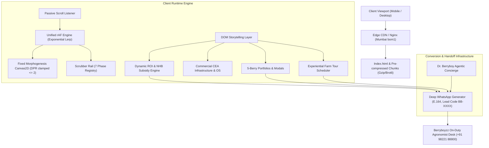

# BERRYBOYZZ™ — System Architecture & Technical Specifications

## 1. System Topology Overview

## 2. Morphogenesis Engine Specifications

### Frame-Rate Budget & Memory Constraints
- **Target FPS:** 60fps (mobile) / 120fps (ProMotion / High-Hz displays).
- **Backing Store Scaling:** `canvas.width = window.innerWidth * Math.min(window.devicePixelRatio, 2)`. Clamped at 2.0 to prevent texture memory spikes (>60MB) on high-DPI iOS/Android devices.
- **Scroll Synchronization:** Passive scroll listener only records `window.scrollY` into an internal reference; zero `getBoundingClientRect` or DOM reads inside the active animation tick.
- **Parametric Morphing:** Geometry is computed via pre-baked mathematical curves (Bezier curves for palmate leaf midribs, polar coordinate drupelet packing for aggregate fruit, radial gradients for specular reflections).

### The 7-Phase Chronological Morphogenesis Pipeline

| Phase Index | Range ($p$) | Anatomical Focus | Visual & Biochemical Parameters |
|---|---|---|---|
| **01 SEED** | $0.00 - 0.14$ | Embryonic Primocane Seed | 0.4g ovoid seed, golden ratio reticulation, micro-pulse respiration, germination crack at tip. |
| **02 RHIZO** | $0.14 - 0.28$ | Rhizosphere Roots | Downward branching L-system roots in coco-peat, air-fill porosity $>22\%$, Bacto-liquid uptake. |
| **03 CANOPY** | $0.28 - 0.42$ | Vegetative CEA Foliage | T-trellis cane ascent, palmate serrated leaves, chlorophyll gradient, solar radiation tracking. |
| **04 BLOOM** | $0.42 - 0.57$ | Anthesis & Blossom | 5 white petals, 20 golden stamens, floating micro-pollen, 100% conical bumblebee pollination. |
| **05 RIPEN** | $0.57 - 0.72$ | Drupelet Swelling | Lime-green $\to$ coral blush $\to$ deep ruby/obsidian aggregate drupelets, $14.2^\circ$ Brix accumulation. |
| **06 HARVEST** | $0.72 - 0.86$ | Precision Abscission | Stem detachment, morning dew particle burst, forced-air $2^\circ\text{C}-4^\circ\text{C}$ thermal pull-down vapor. |
| **07 PUNNET** | $0.86 - 1.00$ | Luxury Cold-Chain Table | 125g crystal vented punnet, condensation mist, gold embossed seal, table surface reflection. |

---

## 3. Financial & Agronomic Computation Engine

### National Horticulture Board (NHB) Subsidy Formula
$$\text{Subsidy} = \begin{cases} \min(0.45 \times \text{Capex}_{\text{Gross}}, 50,00,000) & \text{if subsidy enabled} \\ 0 & \text{otherwise} \end{cases}$$

### Annual Net EBITDA & Breakeven Horizon
$$\text{Revenue}_{\text{Annual}} = \text{Acres} \times \text{Yield}_{\text{Base}} \times \text{Multiplier}_{\text{Model}} \times \text{Price}_{\text{Wholesale}}$$
$$\text{Opex}_{\text{Annual}} = (\text{Acres} \times \text{Opex}_{\text{Base}}) + (0.12 \times \text{Revenue}_{\text{Annual}})$$
$$\text{EBITDA}_{\text{Net}} = \text{Revenue}_{\text{Annual}} - \text{Opex}_{\text{Annual}}$$
$$\text{Breakeven}_{\text{Months}} = \left( \frac{\text{Capex}_{\text{Net}}}{\text{EBITDA}_{\text{Net}}} \right) \times 12$$

---

## 4. Deep WhatsApp Lead Routing Protocol

### Browser Safety Mandates
1. **Digits-Only E.164:** `919822188800`.
2. **Synchronous Gesture Execution:** The link is opened directly inside the user's click gesture stack via `window.open(url, '_blank', 'noopener,noreferrer')`. This prevents iOS Safari and Android Chrome popup blockers from silently dropping the lead handoff.
3. **Unique Lead Tracking Token:** Every deep link embeds a cryptographic session reference:
   $$\text{Token} = \text{PREFIX} - \text{Base36(Timestamp)} - \text{Random36}$$
   e.g. `BB-PUN-7F3K-9A2`.
4. **Buffer Safe:** Prose payloads are bounded below 300 characters to prevent buffer truncation across legacy mobile WhatsApp clients.
